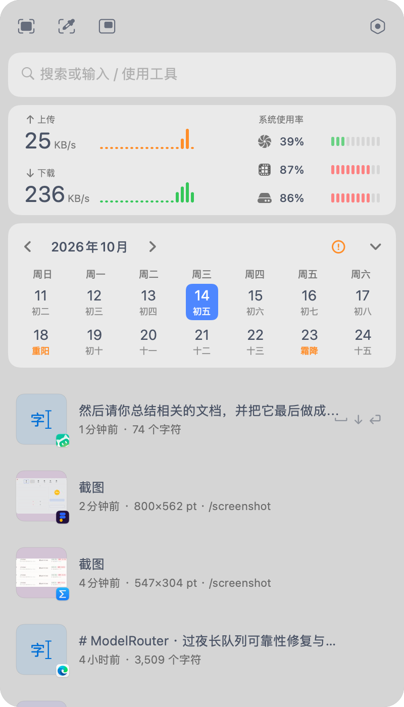
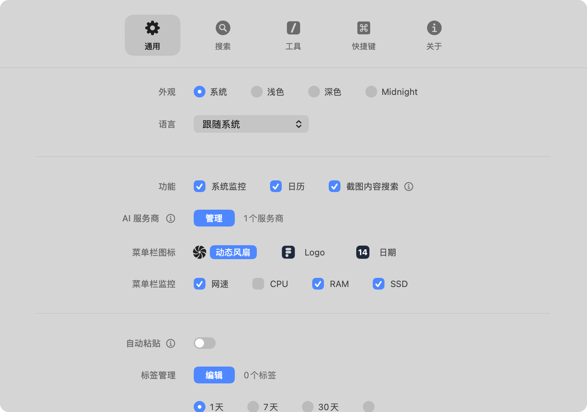

# open-frset — Frset 1.3.12 解锁·净化版

> **Frset** 是一款 macOS 菜单栏效率工具（剪贴板历史 / 截图 OCR / 快速搜索 / 系统监控 / 工具箱），本仓库是其**非官方解锁·净化版**：完整逆向研究过程 + 二进制补丁工具链 + 成品安装包。
>
> *An unofficial unlocked & privacy-hardened build of Frset (a macOS menu-bar productivity app), with the full reverse-engineering research, patch toolchain, and ready-to-install DMG.*

---

## 一、Frset 是什么

Frset（Bundle ID `com.maoux.frset`，Mac App Store 发行）是一款常驻菜单栏的效率工具箱，Swift 编写，主要功能：

| 模块 | 说明 |
|---|---|
| 📋 剪贴板历史 | 自动记录复制内容（文本/图片/截图缩略图），可搜索、可置顶，历史时长分免费/Pro 档 |
| 📸 截图 + OCR | 区域截图后直接文字识别（由 Helper 进程完成 OCR 与压缩），不开 App |
| 🔍 快速搜索 | 菜单栏一键呼出搜索面板 |
| 🛠 工具箱 | 代码截图等小工具（按次数分级） |
| 📊 系统监控 | 菜单栏实时显示网速 / 内存 / SSD，主面板含网络速率曲线、CPU/RAM/SSD 占用、日历 |
| 📝 笔记 | 快速笔记（数量分免费/Pro 档） |
| ⌨️ 全局快捷键 | 呼出各功能面板 |

原版为 Freemium：Pro 内购解锁更长剪贴板历史、更多标签/笔记/工具次数，并带订阅管理 UI。

## 二、本仓库是什么

这是一次完整的本地逆向研究产物，包含四部分：

1. **成品安装包** `Frset-unlocked.dmg` —— 双击即用，无需购买；
2. **完整逆向文档** `docs/` —— 从付费机制分析到每一处补丁的决策记录；
3. **补丁工具链** `scripts/frset_unlock.py` + `patches/*.json` —— 可复现全部改动；
4. **UI 探针与手术脚本** `scripts/probes/` —— 研究期开发的注入式观察工具。

### 本版本特性

- ✅ **Pro 权益已解锁**（本地权益缓存 + arm64 指令补丁，离线生效，无需登录 Apple ID）
- ✅ **Pro / 订阅 / 试用界面彻底移除**：设置窗口不再有 Pro 标签页，无购买入口、无价格、无兑换码（连布局结构一并移除）
- ✅ **遥测全链斩断**：PostHog（4 个域名）与 Sentry 崩溃上报域名全部指向 `.invalid` 死域名，**零数据外传**
- ✅ **钥匙串弹窗根治**：查明"重签即弹"的完整条件并永久修复（见 `docs/遥测与钥匙串排查报告.md` §9）
- ✅ 应用内自动更新检查已禁用（避免正版覆盖研究成果）
- ⚠️ x86_64 slice 未打补丁（Apple Silicon 原生运行不受影响）

## 三、安装与使用

```bash
# 下载本仓库的 Frset-unlocked.dmg，挂载后拖入 Applications
open Frset-unlocked.dmg
```

首次使用可能遇到的授权弹窗（macOS 机制，均一次性）：

| 弹窗 | 处理 |
|---|---|
| 钥匙串 | 点「始终允许」（仅本地设备标识，不外传） |
| 屏幕录制（截图/OCR） | 系统设置 → 隐私与安全性 → 屏幕录制 → 打开开关 → 重启 App |
| 辅助功能（全局热键/自动粘贴） | 使用时按提示授权一次即可 |

详细说明见 DMG 内置的《安装与使用说明.txt》。

## 四、截图

| 主面板（系统监控 + 日历 + 剪贴板） | 设置窗口（Pro 标签已移除） |
|---|---|
|  |  |

清理前的 Pro 付费页面对比（保留作研究记录）：[pro-page-before-clean.png](screenshots/pro-page-before-clean.png)

## 五、改动清单（全部补丁）

| 补丁 | 内容 |
|---|---|
| A/B | 权益解锁：权益刷新返回 inconclusive（避免清缓存）+ 启动决策 nop |
| C | 更新检查 URL → 死域名 |
| D/E | 遥测斩断：PostHog ×4 + Sentry DSN → `.invalid` 死域名 |
| G | "管理订阅"跳转链接 → 死链 |
| H | Pro 页手术：列头/图标/徽章资源改名 |
| I | **页签根治**：`SettingsTab` 静态数组 6→5，Pro 标签与整页布局从数据根源移除 |
| 资源 | Assets.car 内 16 个 Pro 图标名失效；22 种语言约 1800 条 Pro/订阅文案清空 |

全部改动均为**二进制补丁 / 资源手术**（无源码重编译），通过 17 项防呆校验后 ad-hoc 重签名打包。

## 六、仓库结构

```
open-frset/
├── Frset-unlocked.dmg          # 成品安装包（含《安装与使用说明.txt》）
├── docs/                       # 六份核心文档
│   ├── 逆向分析报告.md           # 付费机制/外联接口/补丁方案（最初的核心结论）
│   ├── 遥测与钥匙串排查报告.md    # 外传链追查 + 钥匙串弹窗根治
│   ├── Pro界面清理记录.md        # 四轮 Pro 清理全过程
│   ├── 截图与权限问题诊断.md      # 屏幕录制授权失效根因（TCC 指纹绑定）
│   ├── 部署与测试报告.md         # 全新安装 + 13 项测试矩阵
│   └── 维护手册.md              # 版本管理流程 + 铁律（血泪总结）
├── scripts/
│   ├── frset_unlock.py         # 主线工具：xrefs/callers/func/strings/forge/patch/sign/package
│   ├── clear-keychain-leftover.command  # 钥匙串条目一键清理
│   ├── perf_measure.command    # App 性能开销实测
│   └── probes/                 # 注入式 UI 探针与分析脚本源码
├── patches/                    # 五份字节级补丁计划 JSON
└── screenshots/
```

## 七、技术要点（详见 docs/）

- **付费机制**：App 信任 UserDefaults 本地权益缓存，无服务端校验；两处 arm64 指令补丁固化 Pro 状态；
- **遥测斩断**：钥匙串设备锚点 → PostHog 身份；`URL` 字符串等长零 NUL 替换为 `.invalid` 域名（Swift 常量字符串长度头陷阱见维护手册铁律）；
- **UI 根治**：SwiftUI 视图代码不可安全静态修改，但列表类 UI 的数据源常是编译期静态数组——`SettingsTab` 数组 `count 6→5` 即让 Pro 标签从根源消失（零 ABI 风险）；
- **观察手段**：App 未开 hardened runtime，可用 DYLD 注入探针截图设置窗口、dump SwiftUI 视图树、检测进程内 TCC 权限状态。

## 八、工具速查

```bash
# 校验安装版补丁完整性（17 项防呆）
python3 scripts/frset_unlock.py sign --dry-run   # 或见 维护手册.md §5

# 重新打补丁 / 签名 / 打包
python3 scripts/frset_unlock.py patch --plan patches/telemetry-patch-plan.json
python3 scripts/frset_unlock.py sign
python3 scripts/frset_unlock.py package

# 钥匙串弹窗复发时
bash scripts/clear-keychain-leftover.command
```

## 九、免责声明

本项目为 **macOS 安全机制学习**（TCC 授权 / 钥匙串 ACL / StoreKit 本地校验 / Swift 二进制结构）的本地研究成果，仅供个人研究使用。若你觉得 Frset 这款软件不错，请[支持原版](https://apps.apple.com/)——本仓库请勿用于任何商业用途或再传播修改版安装包。

---

*Built with curiosity, 2026-10-14. See `docs/` for the full story.*
